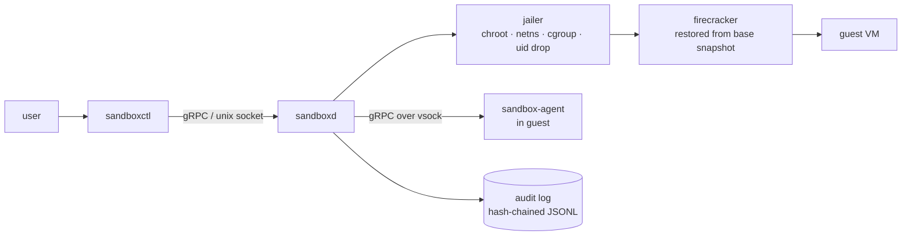

# MicroVM Sandbox

**Run untrusted code in disposable Firecracker microVMs, each restored from a saved snapshot in milliseconds.**

AI agents and scripts run code with our permissions, and one bad command can delete files or leak secrets. Containers share the host kernel, so a kernel bug can break out of them. Full VMs are safe but take seconds to start. MicroVM Sandbox gives **every run its own hardware-isolated microVM**. It restores the VM from a copy-on-write snapshot, applies a per-run policy (CPU, memory, files, network), runs the command and destroys everything afterwards.

> **Status:** week 4 of 13, **Demo 1**. `sandboxd` restores a clone of a base snapshot for every `sandboxctl run` in about 20 ms (a cold boot takes about 80 ms to reach the agent), gives it its own scratch disk at `/work`, streams the command's output, destroys the clone and writes a hash-chained audit record. Three clones run at once from one snapshot, each seeing only its own writes (`make demo1`, and as a test in `make e2e`). Clones run rootless by default. Jailer mode (chroot, its own UID and cgroup per clone) needs root: several manual root runs of the jailer tests on the dev machine on 2026-11-24 passed, a jailed restore in 29–61 ms and Demo 1 through a jailer-mode daemon with three jailed UIDs; they are by hand, never in CI, and `scripts/demo1.sh --jailer` has not been run end to end yet ([ADR-0005](docs/adr/0005-rootless-and-jailer-modes.md)). The feature list is frozen, apart from week 4b: a demo page in the browser (`make demo-ui`, below) and, next, macOS on Apple Silicon; see the [build plan](docs/build-plan.md).
> **Security:** research and teaching project, **not audited**. See [SECURITY.md](SECURITY.md).

## How it works



1. `sandboxctl run -- <command>` sends the request to the daemon over its Unix socket (policies, `--policy p.yaml`, arrive in week 5).
2. `sandboxd` validates the policy (deny by default) and prepares a jailer chroot, a blank scratch disk and a network namespace.
3. Firecracker restores the base snapshot. Guest memory is mapped copy-on-write, so clones share pages until they write.
4. The in-guest agent resyncs the clock, reseeds the RNG, runs the command and streams stdout and stderr back.
5. Everything is torn down and one audit record is written.

## Quickstart

```bash
make firecracker guest snapshots      # once: Firecracker, the guest image, the base snapshots (as yourself)
bin/sandboxd serve &                  # the daemon, rootless, on $XDG_RUNTIME_DIR/sandboxd/sandboxd.sock
until bin/sandboxctl ps > /dev/null 2>&1; do sleep 0.1; done   # wait until it answers (it hashes the store first)
bin/sandboxctl run -- sh -c 'echo hello from a microVM > /work/note; cat note'
bin/sandboxctl run -v --timeout 5s -- sh -c 'uname -r; ls /work'   # -v: every state change and the timings
bin/sandboxctl ps --all               # active and recent runs
bin/sandboxctl logs <run-id>          # the output the daemon kept
bin/sandboxctl audit verify           # check the audit log's hash chain
kill %1                               # stop the daemon: every clone destroyed, socket removed
```

`sandboxctl run` exits with the command's exit code, or 124 if it timed out, 123 if its output hit the cap (`--max-output`, default 1 MiB) and 125 if the run failed. Each run gets a fresh clone with an empty `/work`; nothing is kept between runs. `make demo1` walks through all of it, three clones at once. Policies (`--policy`) arrive in week 5.

## Showing the demo

`make demo-ui` builds everything as you, starts `sandboxd` (rootless) and serves the demo page on this machine only, then prints its address. Open it in a browser: the presenter clicks, `sandboxd` does the work.

```bash
make demo-ui                                   # rootless; prints http://127.0.0.1:8090/?token=...; Ctrl-C stops it all
make demo-ui ARGS='--record demo.jsonl'        # the same, recorded
scripts/demo-ui.sh --jailer                    # jailer mode: only the prebuilt daemon runs with sudo
bin/sandboxctl ui --replay demo.jsonl          # play a recording back (no daemon, no KVM needed)
bin/sandboxctl ui export --from demo.jsonl     # one HTML file: microvm-recording-<date>.html
```

- **The page:** buttons for Demo 1 (three clones, private `/work`), hostile code (`ls -A /home /root; ping -c1 -W1 8.8.8.8; rm /bin/sh`), a fork bomb that hits its 1 s timeout, an output flood that hits its 256 KiB cap, and a custom command line run with `sh -c` in 1 to 8 clones. Each clone gets a lane: its phases as `sandboxd` timed them, its output (shown as text only), the outcome and its audit record's hash. Panels show what `sandboxd` reports about the host (Firecracker processes, run folders, jails, cgroups, each clone's RSS and PSS), the newest audit records with `prev → hash` and a "Verify chain" button, this session's restores next to the cold boot `make snapshots` measured, and the recent runs (also those from the CLI). The header says the mode (rootless is labelled "fallback"), the versions and whether the host is itself a VM.
- **Live and recorded are never mixed up:** only the live page has the LIVE badge. A replay or an export always shows the RECORDING banner with the date and the machine's mode and kind, plays with the original timing (a speed-up is labelled), and runs nothing.
- **Local only:** the page is served on a loopback address with a random token, which the browser keeps in a cookie; other hosts, other web pages and other local users cannot use it ([ADR-0007](docs/adr/0007-local-demo-ui-over-http-and-sse.md), threat model T13). For another machine, send the export: it opens offline from `file://` in any browser.
- Verified on the Linux x86_64 dev machine with KVM (rootless; `make e2e` runs the whole flow). Jailer mode needs the user's own `sudo` run.

## Building from source

Requires:
- Linux with KVM (`/dev/kvm` readable and writable by your user)
- Go 1.27+
- util-linux 2.38 or newer (`unshare --map-auto` builds the guest disk without sudo)
- subordinate uid/gid ranges for your user in `/etc/subuid` and `/etc/subgid` (most distributions add them when the user is created)
- e2fsprogs 1.47 or newer (`mkfs.ext4 -d` builds the guest disk and each snapshot's scratch disk template), curl and bash 5

```bash
make firecracker  # pinned Firecracker + jailer into third_party/, SHA-256 checked
make guest   # pinned guest kernel + rootless Alpine root disk with sandbox-agent into guest/out/
make boot    # boot one microVM through Firecracker's API, run one job, destroy it
make demo    # live walkthrough of the project, one step per Enter
make demo1   # Demo 1: sandboxd runs three clones at once from one snapshot (rootless; scripts/demo1.sh --jailer for jailer mode)
make demo-ui # the demo page in a browser: sandboxd + sandboxctl ui (see "Showing the demo" above)
make build   # bin/sandboxd (the daemon), bin/sandboxctl (the CLI), bin/sandbox-agent (in the guest)
make generate # regenerate the Go code in internal/gen from proto/ (pinned buf)
make test    # unit tests, with the race detector
make snapshots # build the base snapshots (small, medium) into guest/out/state (needs KVM)
make e2e     # boot and restore real microVMs and test the agent inside them (needs KVM; not run in GitHub CI)
make e2e-jailer # a restore and Demo 1 in jailer mode (needs root, see below)
make lint    # pinned golangci-lint, buf lint and go vet
make         # list every target
```

### Jailer mode (needs root)

Everything above runs as your own user: the clones run in **rootless mode**. **Jailer mode** puts each clone's Firecracker in a chroot, as an unprivileged UID of its own (70000 + its slot), in its own cgroup ([ADR-0005](docs/adr/0005-rootless-and-jailer-modes.md)). The jailer has to start as root. Nothing is ever built as root: everything is compiled as you, and only one prebuilt binary runs with sudo.

The tests (one restore, then Demo 1 through a jailer-mode daemon inside the test binary):

```bash
make snapshots                     # as yourself: the store the tests restore from
go test -c -tags 'e2e jailer' -o bin/e2e-jailer.test ./test/e2e   # as yourself
sudo bin/e2e-jailer.test -test.run Jailer -test.v                 # the only step that runs as root
```

`make e2e-jailer` runs exactly these three steps (it asks for your sudo password at the last one). As root, the tests create only jail folders under `guest/out/state/jail/` and cgroups under `/sys/fs/cgroup/microvm/`, and remove them; Demo 1 also adds three records to your audit log, which stays yours. If a cleanup fails, they print the `sudo rm -rf …` or `sudo rmdir …` that finishes the job. Without root, the binary skips the tests.

Demo 1 in jailer mode, from a terminal (it builds as you, prints the one sudo command, then runs it):

```bash
scripts/demo1.sh --jailer
# runs, as root, only:  sudo bin/sandboxd serve --jailer --state-dir guest/out/state --socket-group <your gid>
```

The jailer-mode daemon listens on `/run/sandboxd/sandboxd.sock` (0660, group `sandbox` if it exists, else `--socket-group`, else root only; [ADR-0006](docs/adr/0006-daemon-socket-and-state-ownership.md)) and gives the audit log and the lock file in the state folder to the folder's owner, so `sandboxctl audit verify` and rootless mode keep working as you.

The last root runs (2026-11-24, dev machine, binaries built from 9245d10; run several times) all passed: `TestJailerRestore` with every subtest (the jailed UID, no supplementary groups, the cgroup limits, read-only links, `/work`), and `TestJailerDemo1`, three clones at once through a jailer-mode daemon, as UIDs 70000, 70001 and 70002, each in its own cgroup, all exit 0, about 2.2 s wall time for three 2 s commands. Jailed restores took 28.6–60.5 ms in all across the runs, and each Demo 1 clone's restore 40–48 ms (three at once), against about 18–23 ms rootless; most of the difference is the jailer's own start. The latest log is `guest/out/jailer-test.log` (not committed): restore 37.6 ms (prepare 0.7, scratch 0.2, process start 22.6, LoadSnapshot 7.4, agent ready 5.6, de-twin 1.1 ms); Demo 1 restores 46.7–47.4 ms, wall time 2.19 s. `scripts/demo1.sh --jailer` still needs its first run end to end.

If a root run is interrupted (Ctrl-C, a timeout) before it cleans up, finish by hand. `<id>` is the `r-…` folder under `guest/out/state/jail/firecracker/`:

```bash
for uid in $(seq 70000 70031); do sudo pkill -KILL -u "$uid"; done   # jailed Firecrackers (UID 70000 + slot)
sudo rm -rf guest/out/state/jail/firecracker/<id>    # its chroot
sudo rmdir guest/out/state/jail/firecracker          # the shared parent, once it is empty
find /sys/fs/cgroup/microvm -mindepth 1 -maxdepth 1 -type d     # clone cgroups left, if any (not the control files)
sudo rmdir /sys/fs/cgroup/microvm/<id> /sys/fs/cgroup/microvm   # its cgroup, then the parent
sudo rm -f /run/sandboxd/sandboxd.sock               # a jailer-mode daemon's socket, if it was killed
```

## Roadmap

| Week | Milestone |
|------|-----------|
| 4 | Demo 1: three clones at once from one snapshot, each with its own writes (done: `make demo1`) |
| 8 | Demo 2: networking off by default; policies change the limits |
| 9 | Escape-test suite: every attempt blocked or logged |
| 10 | Benchmarks: p50/p99 restore latency, clones per GB |
| 13 | Final report and demo |

## Documentation

- [Build plan](docs/build-plan.md): week-by-week tasks, risks, hour log
- [Threat model](docs/threat-model.md): attacker, trust boundaries, mitigations
- Architecture decisions: [0001 Go](docs/adr/0001-go-for-all-components.md) · [0002 gRPC](docs/adr/0002-grpc-for-apis.md) · [0003 snapshot constraints](docs/adr/0003-snapshot-constraints.md) · [0004 Alpine guest](docs/adr/0004-alpine-guest-rootfs.md) · [0005 rootless and jailer modes](docs/adr/0005-rootless-and-jailer-modes.md) · [0006 daemon socket and state ownership](docs/adr/0006-daemon-socket-and-state-ownership.md) · [0007 local demo UI over HTTP and SSE](docs/adr/0007-local-demo-ui-over-http-and-sse.md)
- [Learning docs](docs/learn/README.md): how every part works, starting from zero with [the big picture](docs/learn/00-big-picture.md); the daemon and the life of one run, and the demo page, in [doc 11](docs/learn/11-the-daemon-and-a-run.md)

## Stack

Linux + KVM · Firecracker + jailer · Go (daemon, CLI, guest agent) · gRPC/protobuf · HTTP + Server-Sent Events and vanilla JavaScript (the demo page) · nftables · cgroup v2 · pytest (escape tests) · Python (benchmarks)
