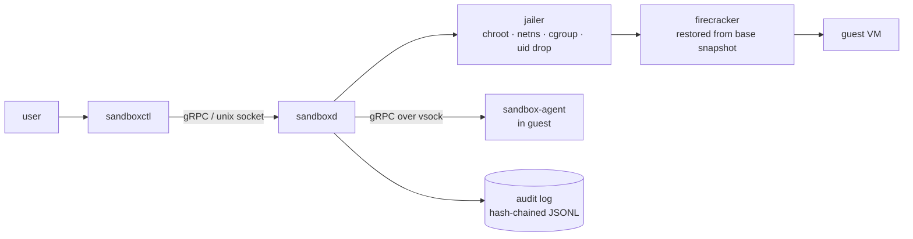

# MicroVM Sandbox

**Run untrusted code in disposable Firecracker microVMs, each restored from a saved snapshot in milliseconds.**

AI agents and scripts run code with our permissions, and one bad command can delete files or leak secrets. Containers share the host kernel, so a kernel bug can break out of them. Full VMs are safe but take seconds to start. MicroVM Sandbox gives **every run its own hardware-isolated microVM**. It restores the VM from a copy-on-write snapshot, applies a per-run policy (CPU, memory, files, network), runs the command and destroys everything afterwards.

> **Status:** week 0 of 13. The three programs build, but so far they only print their version. Real microVMs arrive from week 1. See the [build plan](docs/build-plan.md).
> **Security:** research and teaching project, **not audited**. See [SECURITY.md](SECURITY.md).

## How it works



1. `sandboxctl run --policy p.yaml -- <command>` sends the request to the daemon.
2. `sandboxd` validates the policy (deny by default) and prepares a jailer chroot, a blank scratch disk and a network namespace.
3. Firecracker restores the base snapshot. Guest memory is mapped copy-on-write, so clones share pages until they write.
4. The in-guest agent resyncs the clock, reseeds the RNG, runs the command and streams stdout and stderr back.
5. Everything is torn down and one audit record is written.

## Planned usage

```bash
sandboxctl run --policy policies/default.yaml -- python3 -c 'print("hello from a microVM")'
sandboxctl ps
sandboxctl logs <run-id>
```

## Building from source

Requires Linux with KVM and Go 1.27+.

```bash
make build   # bin/sandboxd, bin/sandboxctl, bin/sandbox-agent
make test    # unit tests, with the race detector
make lint    # pinned golangci-lint
make         # list every target
```

## Roadmap

| Week | Milestone |
|------|-----------|
| 4 | Demo 1: three clones at once from one snapshot, each with its own writes |
| 8 | Demo 2: networking off by default; policies change the limits |
| 9 | Escape-test suite: every attempt blocked or logged |
| 10 | Benchmarks: p50/p99 restore latency, clones per GB |
| 13 | Final report and demo |

## Documentation

- [Build plan](docs/build-plan.md): week-by-week tasks, risks, hour log
- [Threat model](docs/threat-model.md): attacker, trust boundaries, mitigations
- Architecture decisions: [0001 Go](docs/adr/0001-go-for-all-components.md) · [0002 gRPC](docs/adr/0002-grpc-for-apis.md) · [0003 snapshot constraints](docs/adr/0003-snapshot-constraints.md)
- [Learning docs](docs/learn/README.md): how every part works, starting from zero with [the big picture](docs/learn/00-big-picture.md)

## Stack

Linux + KVM · Firecracker + jailer · Go (daemon, CLI, guest agent) · gRPC/protobuf · nftables · cgroup v2 · pytest (escape tests) · Python (benchmarks)
