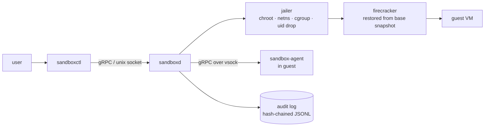

# MicroVM Sandbox

**Run untrusted code in disposable Firecracker microVMs, each restored from a saved snapshot in milliseconds.**

AI agents and scripts run code with our permissions, and one bad command can delete files or leak secrets. Containers share the host kernel, so a kernel bug can break out of them. Full VMs are safe but take seconds to start. MicroVM Sandbox gives **every run its own hardware-isolated microVM**. It restores the VM from a copy-on-write snapshot, applies a per-run policy (CPU, memory, files, network), runs the command and destroys everything afterwards.

> **Status:** week 3 of 13. `make snapshots` saves a booted microVM, with `sandbox-agent` running inside, as a base snapshot per size class, and `make e2e` restores clones from it in about 15–20 ms (a cold boot takes about 80 ms to reach the agent), resets each clone's clock and random state, runs commands over gRPC on vsock and destroys the clone. Clones run rootless by default. Jailer mode (chroot, UID drop, cgroup limits) needs root: it passed one manual root run on the dev machine on 2026-11-18, restoring a clone in 51.4 ms, and that run is by hand, not in CI ([ADR-0005](docs/adr/0005-rootless-and-jailer-modes.md)). `sandboxd` and `sandboxctl` arrive in week 4. See the [build plan](docs/build-plan.md).
> **Security:** research and teaching project, **not audited**. See [SECURITY.md](SECURITY.md).

## How it works



1. `sandboxctl run --policy p.yaml -- <command>` sends the request to the daemon.
2. `sandboxd` validates the policy (deny by default) and prepares a jailer chroot, a blank scratch disk and a network namespace.
3. Firecracker restores the base snapshot. Guest memory is mapped copy-on-write, so clones share pages until they write.
4. The in-guest agent resyncs the clock, reseeds the RNG, runs the command and streams stdout and stderr back.
5. Everything is torn down and one audit record is written.

## Planned usage

```bash
sandboxctl run --policy policies/default.yaml -- python3 -c 'print("hello from a microVM")'
sandboxctl ps
sandboxctl logs <run-id>
```

## Building from source

Requires:
- Linux with KVM (`/dev/kvm` readable and writable by your user)
- Go 1.27+
- util-linux 2.38 or newer (`unshare --map-auto` builds the guest disk without sudo)
- subordinate uid/gid ranges for your user in `/etc/subuid` and `/etc/subgid` (most distributions add them when the user is created)
- e2fsprogs 1.47 or newer (`mkfs.ext4 -d` builds the guest disk and each snapshot's scratch disk template), curl and bash 5

```bash
make firecracker  # pinned Firecracker + jailer into third_party/, SHA-256 checked
make guest   # pinned guest kernel + rootless Alpine root disk with sandbox-agent into guest/out/
make boot    # boot one microVM through Firecracker's API, run one job, destroy it
make demo    # live walkthrough of the project, one step per Enter
make build   # bin/sandboxd, bin/sandboxctl, bin/sandbox-agent
make generate # regenerate the Go code in internal/gen from proto/ (pinned buf)
make test    # unit tests, with the race detector
make snapshots # build the base snapshots (small, medium) into guest/out/state (needs KVM)
make e2e     # boot and restore real microVMs and test the agent inside them (needs KVM; not run in GitHub CI)
make e2e-jailer # the same restore in jailer mode (needs root, see below)
make lint    # pinned golangci-lint, buf lint and go vet
make         # list every target
```

### Jailer mode (needs root)

Everything above runs as your own user: the clones run in **rootless mode**. **Jailer mode** puts each clone's Firecracker in a chroot, as an unprivileged user, in its own cgroup ([ADR-0005](docs/adr/0005-rootless-and-jailer-modes.md)). The jailer has to start as root. Nothing is ever built as root, so the test is compiled into one binary as you, and only that binary runs with sudo:

```bash
make snapshots                     # as yourself: the store the test restores from
go test -c -tags 'e2e jailer' -o bin/e2e-jailer.test ./test/e2e   # as yourself
sudo bin/e2e-jailer.test -test.run Jailer -test.v                 # the only step that runs as root
```

`make e2e-jailer` runs exactly these three steps (it asks for your sudo password at the last one). As root, the test creates only a jail folder under `guest/out/state/jail/` and a cgroup under `/sys/fs/cgroup/microvm/`, and removes both. If a cleanup fails, it prints the `sudo rm -rf …` or `sudo rmdir …` that finishes the job. Without root, the binary skips the test.

The last run (2026-11-18, dev machine) passed: restore in jailer mode took 51.4 ms (prepare 0.4, process start 36.6, LoadSnapshot 7.2, agent ready 6.0, de-twin 1.2 ms), against about 15–20 ms rootless.

If a root run is interrupted (Ctrl-C, a timeout) before it cleans up, finish by hand. `<id>` is the `r-…` folder under `guest/out/state/jail/firecracker/`:

```bash
sudo pkill -KILL -u 70000                            # the jailed Firecracker (UID 70000)
sudo rm -rf guest/out/state/jail/firecracker/<id>    # its chroot
sudo rmdir guest/out/state/jail/firecracker          # the shared parent, once it is empty
sudo rmdir /sys/fs/cgroup/microvm/<id> /sys/fs/cgroup/microvm   # its cgroup, then the parent
```

## Roadmap

| Week | Milestone |
|------|-----------|
| 4 | Demo 1: three clones at once from one snapshot, each with its own writes |
| 8 | Demo 2: networking off by default; policies change the limits |
| 9 | Escape-test suite: every attempt blocked or logged |
| 10 | Benchmarks: p50/p99 restore latency, clones per GB |
| 13 | Final report and demo |

## Documentation

- [Build plan](docs/build-plan.md): week-by-week tasks, risks, hour log
- [Threat model](docs/threat-model.md): attacker, trust boundaries, mitigations
- Architecture decisions: [0001 Go](docs/adr/0001-go-for-all-components.md) · [0002 gRPC](docs/adr/0002-grpc-for-apis.md) · [0003 snapshot constraints](docs/adr/0003-snapshot-constraints.md) · [0004 Alpine guest](docs/adr/0004-alpine-guest-rootfs.md) · [0005 rootless and jailer modes](docs/adr/0005-rootless-and-jailer-modes.md)
- [Learning docs](docs/learn/README.md): how every part works, starting from zero with [the big picture](docs/learn/00-big-picture.md)

## Stack

Linux + KVM · Firecracker + jailer · Go (daemon, CLI, guest agent) · gRPC/protobuf · nftables · cgroup v2 · pytest (escape tests) · Python (benchmarks)
